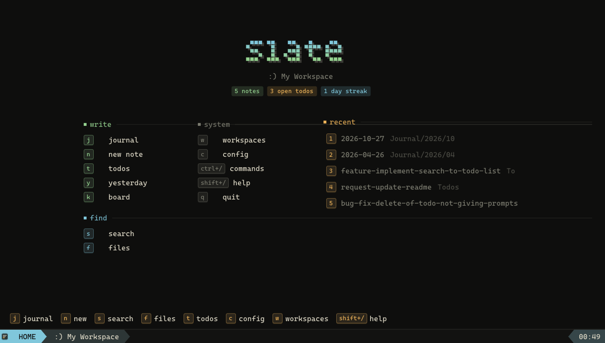
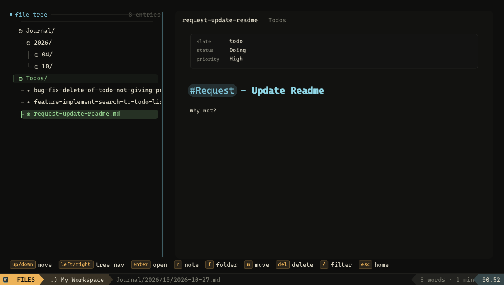
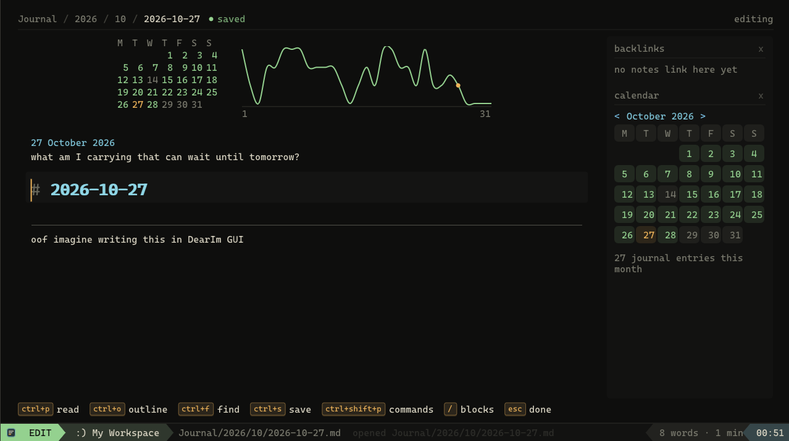
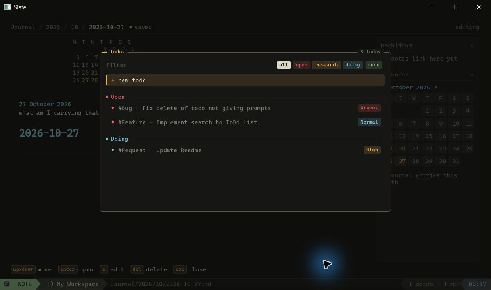
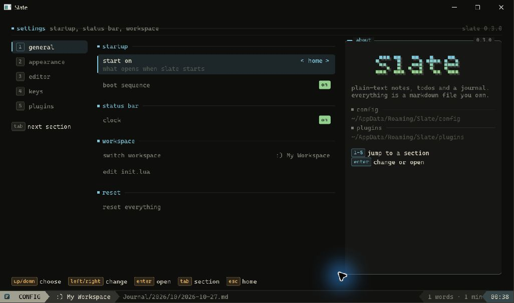

<div align="center">
  
  <h1>Slate</h1>
  <p><strong>A quiet, local-first home for Markdown notes, journals, and todos.</strong></p>

  <p>
    <a href="https://github.com/mykaadev/Slate/releases"></a>
    <a href="https://github.com/mykaadev/Slate/issues"></a>
    <a href="LICENSE"></a>
  </p>
</div>



Slate is a small desktop writing app. Your workspace is a normal folder, and every note stays a normal Markdown file.

There is no account, cloud database, or custom file format. Open a folder, write, and keep your files.

## Why Slate?

Many writing tools start simple and grow into a second operating system. Slate tries to stay small.

- Local files that you can sync or back up yourself
- A focused interface with keyboard-first navigation
- Live Markdown preview without a separate editor pane
- Daily journals and standalone todo files
- Lua plugins for the features that do not belong in the core app

## Screens

### Browse your workspace

Use the file tree to move through folders and preview notes before you open them.



### Write a daily journal

Press `j` to open today's entry. Slate stores it at `Journal/YYYY/MM/YYYY-MM-DD.md`.



### Keep todos as files

Each todo is a Markdown document under `Todos/`. The frontmatter stores its state and priority.



### Make it yours

Choose a theme, font, editor layout, motion level, and shortcut set from the settings screen.



## Features

### Notes

- Live Markdown preview
- Headings, callouts, tables, code, math, images, and checkboxes
- Reading view and a heading outline
- Markdown links and `[[Wiki Links]]`
- File-name, full-text, and recent-file search
- Recovery files and local history snapshots

### Journals and todos

- Daily notes with a calendar and activity view
- Standalone todo documents
- Open, Research, Doing, and Done states
- Low, Normal, High, and Urgent priorities
- Todo creation from `/todo` or the todo panel

### Customization

- Bindable keyboard shortcuts
- Separate app and Markdown color presets
- Installed monospace font selection
- Lua commands, views, sidebars, themes, and status items
- Bundled calendar, backlinks, Kanban, word-count, and editing plugins

Read the [plugin guide](docs/PLUGINS.md) for the full Lua API.

## Quick start

### Windows portable build

1. Download the latest ZIP from [Releases](https://github.com/mykaadev/Slate/releases).
2. Extract the ZIP to a folder.
3. Run `Slate.exe`.
4. Create a workspace or open an existing folder.

Slate stores user settings in `%APPDATA%/Slate/`. It stores your notes only in the workspace that you select.

## Useful shortcuts

| Shortcut | Action |
| --- | --- |
| `j` | Open today's journal |
| `n` | Create a note |
| `s` | Search the workspace |
| `f` | Browse files |
| `t` | Open todos |
| `c` | Open settings |
| `w` | Switch workspaces |
| `ctrl+p` | Toggle reading view |
| `ctrl+o` | Toggle the outline |
| `ctrl+shift+p` | Open the command palette |
| `/` | Open editor commands |

All shortcuts are available in [docs/SHORTCUTS.md](docs/SHORTCUTS.md).

## File layout

Slate does not hide your data. A workspace can look like this:

```text
My Workspace/
  Journal/
    2026/
      10/
        2026-10-27.md
  Notes/
  Projects/
  Todos/
  .slate/
```

The `.slate/` folder holds workspace recovery data, history, and optional theme presets.

## Build from source

Requirements:

- CMake 3.15 or newer
- A C++17 compiler
- OpenGL
- Windows for the primary supported build

```powershell
cmake -S . -B build
cmake --build build --config Release
ctest --test-dir build -C Release --output-on-failure
```

### Build the portable ZIP

```powershell
cmake --build build --config Release --target portable
```

CMake writes the package to `build/portable/`.

## Project structure

```text
assets/       bundled themes and plugins
docs/         architecture and feature guides
resources/    README images and the app icon
src/App/      Slate services and UI
src/Framework shared runtime and platform code
src/Modes/    app screens
tests/        core tests
```

## Contributing

Bug reports and focused pull requests are welcome. Start with the [architecture guide](docs/ARCHITECTURE.md) before a large change.

## License

Slate uses the [MIT License](LICENSE).

<div align="center">
  <a href="https://buymeacoffee.com/mykaadev">Buy me a coffee</a>
</div>
